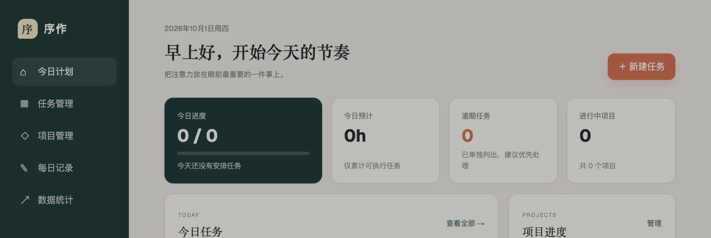
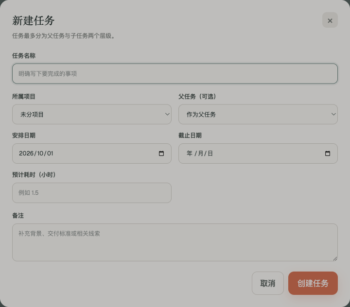

# 序作 · 个人计划与项目管理

将项目、任务和每日记录放在同一工作台，帮助安排今天要做的事并回顾投入时间。对应原服务器的 8443 端口。

## 界面截图

概览截图中的任务与项目数量已替换为演示值，且未展示真实任务名称；任务表单为空白状态。

## 功能

- **今日计划**：集中显示今日进度、预计用时、逾期任务和进行中项目，并区分今天安排与逾期事项。
- **任务管理**：创建、修改、完成和筛选任务；任务可组织为父任务与子任务两个层级，父任务根据子任务进度汇总状态。
- **时间记录**：为任务设置安排日期、截止日期和预计耗时；完成任务时记录实际耗时，并汇总到项目统计。
- **项目管理**：建立项目并将任务归入项目，查看项目进度与投入情况。
- **每日记录与统计**：在独立页面记录每天的工作，并查看基于任务和项目数据生成的统计视图。
- **安全删除提示**：删除任务或项目时显示影响范围，例如父任务与子任务的关系。

## 源码与数据

项目使用 React、TypeScript、Vinext、Drizzle 和 D1 兼容数据库接口。公开仓库只保存程序源码；真实任务、项目、每日记录及数据库文件未上传。

需要 Node.js 22.13.0 或更新版本。开发与构建命令：

    npm ci
    npm run dev
    npm run build

构建后的自托管入口：

    HOST=127.0.0.1 PORT=3103 node server.js

数据库绑定与持久化方式由部署环境提供。
